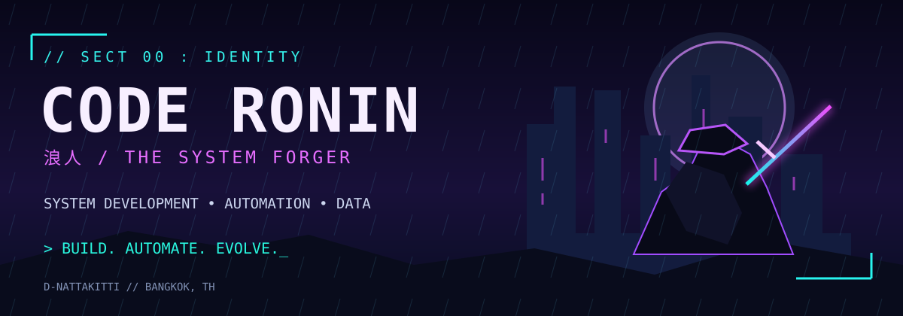

<div align="center">



### `浪人 // THE CODE RONIN`

**Nattakitti · System Development / Automation / Data**

*“I don't just write code. I forge systems.”*

  

[](https://www.linkedin.com/in/dome-nattakitti/) [](https://github.com/D-Nattakitti)

</div>

---

### `01 // ORIGIN STORY` — About Me

```text
> identify --user D-Nattakitti
> role       : System Development & Automation
> specialties: Business workflows, web apps, data operations
> approach  : Understand the process → design → build → improve
> mode      : Always learning
[ ACCESS GRANTED ]
```

I'm a Thailand-based developer focused on the intersection of **systems, data, and automation**. I build practical internal tools, connect workflows, improve data reliability, and turn repetitive work into more manageable processes.

My experience spans **Google Apps Script web apps, Python, SQL, Power Automate, JavaScript, and system operations**. I enjoy following the whole problem—from the user's request to the workflow behind it.

### `02 // THE ARSENAL` — Tools & Technologies

| Discipline | Tools I work with |
| :-- | :-- |
| **Code / Web** | Python · JavaScript · HTML · CSS · Node.js · React · PHP |
| **Data / Database** | SQL · MySQL · SQL Server · Excel / VBA · Google Sheets |
| **Workflow Automation** | Google Apps Script · Power Automate · AppSheet · REST APIs |
| **Systems / Infra** | Docker · Ubuntu · Windows Server · Nginx · Git / GitHub |
| **Design / Collaboration** | Figma · Postman · Microsoft Teams |

> **Current training arc:** Advanced SQL · Data modeling · ETL/ELT · API integrations · workflow reliability

### `03 // FIELD MISSIONS` — Selected Work

These are **high-level descriptions only**. Internal implementations, business data, and private source code are not published here.

| Mission | What I built / worked on | Focus |
| :-- | :-- | :-- |
| **BI Team Portal** | Internal portal for systems, links, notices, and team access | Web app · UX · Apps Script |
| **Vehicle Workflow Automation** | Vehicle request and return workflow with notifications and status tracking | Workflow · Automation |
| **Supplier Registration** | Supplier intake and approval automation with duplicate checks and process tracking | Data quality · Automation |
| **BI Reporting & Requests** | Reporting and request workflows to reduce manual coordination | Data · Reporting · Integration |

### `04 // PUBLIC QUEST LOG` — Explore

Public repositories and experiments are available here:

- [How-to-want-Dev-](https://github.com/D-Nattakitti/How-to-want-Dev-) — Development learning repository
- [20262202_Test-WebappPython](https://github.com/D-Nattakitti/20262202_Test-WebappPython) — Python web app experiment
- [Test_Satic_Website](https://github.com/D-Nattakitti/Test_Satic_Website) — Static website experiment

### `05 // BATTLE RECORD` — GitHub Activity

<div align="center">


</div>

<sub>Public repository statistics do not represent all private or professional work. Third-party stat cards may occasionally be unavailable.</sub>

---

<div align="center">

`武 // BUILD` &nbsp;&nbsp; `道 // AUTOMATE` &nbsp;&nbsp; `術 // EVOLVE`

**`> The journey continues. _`**

</div>
