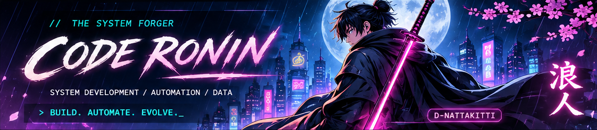

<div align="center">



### `浪人 // THE CODE RONIN`
**Nattakitti — System Development · Automation · Data**

`⚡ SYSTEM ONLINE` &nbsp; `📍 BANGKOK, TH` &nbsp; `⚔️ BUILD / AUTOMATE / EVOLVE`

[](https://www.linkedin.com/in/dome-nattakitti/) [](https://github.com/D-Nattakitti?tab=repositories)

</div>

---

### `01 / WHOAMI`

```bash
$ whoami
> Nattakitti | Developer focused on Systems, Data & Automation

$ cat mission.txt
> Understand the workflow.
> Build practical tools.
> Automate repetitive work.
> Keep learning. Keep improving.
```

I build **internal web apps, workflow automation, and data tools**. My work connects user needs with system design, scripting, databases, and day-to-day operations.

### `02 / TECH ARSENAL`

<div align="center">


</div>

**Also working with:** HTML / CSS · PHP · MySQL · SQL Server · Excel / VBA · Google Sheets · AppSheet · REST APIs · Ubuntu · Nginx · Windows Server

### `03 / MISSION ARCHIVE`

| ⚔️ Mission | Objective | Discipline |
|:--|:--|:--|
| **BI Team Portal** | Centralize internal system access and team information | Web App / UX |
| **Vehicle Workflow** | Streamline vehicle requests, status, and notifications | Automation / Integration |
| **Supplier Registration** | Improve intake, duplicate checks, and approval workflows | Automation / Data Quality |
| **BI Reports & Requests** | Support reporting and request coordination | Data / Workflow |

> 🔒 Professional projects are described at a high level only. Private code, internal links, credentials, and company data are not shared.

### `04 / OPEN QUESTS`

- [**How-to-want-Dev-**](https://github.com/D-Nattakitti/How-to-want-Dev-) — Development learning
- [**Python Web App Experiment**](https://github.com/D-Nattakitti/20262202_Test-WebappPython) — Python practice
- [**Static Website Experiment**](https://github.com/D-Nattakitti/Test_Satic_Website) — Front-end practice

### `05 / BATTLE RECORD`

<div align="center">

[](https://github.com/D-Nattakitti)

*Live contributions and repository activity are available directly on GitHub below this README.*

---

**`武 / BUILD`** &nbsp; **`道 / AUTOMATE`** &nbsp; **`術 / EVOLVE`**

`> THE JOURNEY CONTINUES ... _`

</div>
